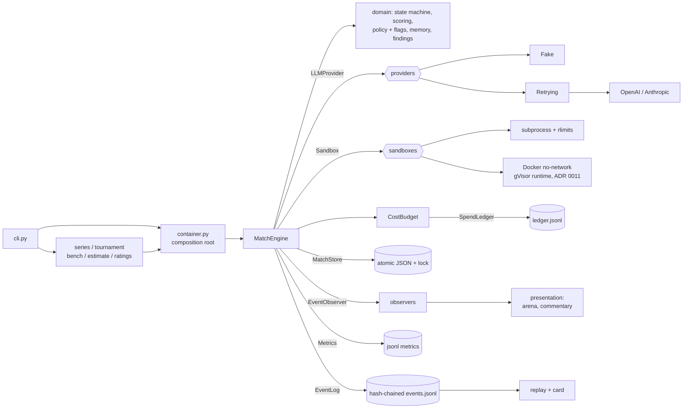

# claude-duel


Two AI agents duel in stages. Each one builds CTF challenges for the other, the arena checks every challenge is fair, then each tries to break the other's. Scoring is deterministic and every match can be replayed.

(Named as a joke on Claude Duet. The idea came from "there should be a claude duel".)

## How a round works
1. **Build**: each agent writes `challenges_per_round` Python programs that print the global `FLAG` only for the right stdin, along with a reference payload.
2. **Validate**: static AST allowlist (pure imports, `sys.stdin`/`sys.stdout` only, no `_` names, size, flag literals), then a sandbox run: the reference payload must reveal the flag; empty and junk input must not, and every input must finish in bounded time. Invalid challenges cost points.
3. **Attack**: the opponent sees the source and description and gets `max_attempts` tries within a token budget, with feedback after each try.
4. **Score**: a pure function. Points scale with difficulty × round, so stakes rise each round.

## Quick start
```bash
uv venv && . .venv/bin/activate && uv pip install -e '.[dev]'
duel run --match-id demo            # fake provider, no network, free; live arena view on a terminal
duel run --view arena --pace 0.15   # animated scoreboard, slowed down to watch (or --view commentary)
duel run --format json              # one JSON summary instead (scripts, CI)
duel card demo [--out card.svg]     # shareable SVG card: models, score, rounds, spend, replay-verified log hash
duel replay demo --transcript       # refold the event log and verify scores
duel replay demo --view arena       # re-watch a finished match in the arena view from its log ($0, no API calls)
duel replay demo --verify           # also re-run logged ghost runs in the sandbox ($0 API)
duel series --games 3                # best-of-3: one normal match per game, sides alternate, then verified
duel tournament                     # round robin (<= 6) or Swiss over the config's [[tournament.entrants]];
                                    # [tournament] pool = true adds a shared, CTFd-decayed challenge pool
duel ratings                        # offline Elo + Bradley-Terry (95% CI) over every completed match
duel estimate [--mode capped]       # offline worst-case $ per match for each preset (no API calls)
duel resume demo                    # continue a crashed or aborted match
duel db migrate                     # apply results-DB migrations (MIGRATE_DATABASE_URL, owner; forward-only)
duel sync [--rebuild]               # load verified event logs into the results DB (DATABASE_URL, ADR 0012)
duel export [--out llm-duels-export.json] # static public JSON via the read-only exporter role (EXPORT_DATABASE_URL)
duel backup [--bucket gs://…]       # copy finished matches' logs + state (flag-scanned, never *.secret) to `DUEL_REPLAY_BUCKET` via gcloud
OPENAI_API_KEY=... duel --config configs/dev.toml run   # real models (see below)
```

To use OpenAI, set `provider = "openai"` on the agents in a config file, as in `tests/e2e/test_cli.py`. Only low-cost models from the price table are allowed (default `gpt-6-luna`).

## Architecture

Lifecycle: `pending → build → validate → attack → score → (build | complete)`, and any stage can go to `failed`, which `resume` recovers from. A match-scoped cap (`match_max_usd`/`_tokens`/`_calls`) instead ends the match in the terminal stage `capped`, naming the agent whose call crossed it; `resume` is a no-op, the CLI exits 3, a series with a capped game ends void (or counts its scored rounds with `scoring.on_cap = "partial"`), and ratings exclude it ([ADR 0014](docs/adr/0014-match-caps.md)). Run and lifetime caps still fail resumably (exit 2). See the [design docs](docs/design/README.md), [docs/design.md](docs/design.md), [requirements](docs/requirements.md) and the [ADRs](docs/adr).

## Cost controls
- Code-defined allowlist of low-cost models (`app/budget.py:DEFAULT_PRICES`); config cannot add models or change prices.
- Per-match caps (calls, tokens, USD; $0.25 dev / $0.50 staging / $1.00 prod), per-run caps, and a persistent ledger (`.duel/ledger.jsonl`) with a $33 lifetime ceiling. Once that ceiling is hit, new work is refused.
- A provider `insufficient_quota` error is never retried. The match fails cleanly and can be resumed later.

## Threat model
| Threat | Mitigation |
|---|---|
| Challenge code escapes the sandbox (network, files, processes) | AST allowlist; flag and source sent over stdin (never argv or environ); real-model matches only run in Docker (`--network none`, read-only rootfs, cap-drop ALL, no-new-privileges, seccomp, non-root, pids/memory/CPU limits, container removed on timeout) and fail closed if the daemon is unreachable; subprocess sandbox (fake provider only) adds rlimits incl. no forks and kills the whole process group |
| Infinite loops and memory bombs | CPU + wall-clock + memory limits; output truncated |
| Flag leakage to the attacker | Flags are HMAC-derived by the arena and never shown to authors; prompts are guarded (`FlagLeakError`); feedback and logs are redacted; flags are never persisted |
| Trivial or unsolvable challenges | Reference payload must succeed; empty and junk input must fail, in bounded time |
| Prompt injection inside challenge text | The attacker only produces stdin. Model output is never executed by the arena, only parsed as JSON |
| Secrets in logs | Keys only come from env and are held as `SecretStr`; the JSON log formatter scrubs keys and flags |
| Score tampering | hash-chained event log; `duel replay` refolds it, rescores and flags mismatches |
| Runaway spend | Budget circuit breaker + ledger ceiling |
| Secrets reaching the results DB or a public page | `duel sync` never opens `*.secret`, stores only an allowlist of event fields (no source, payloads, solver output, notes, flags) run through `scrub`; `duel export` reads only `public_v` views as `duel_exporter` (read-only, no owner/writer rights, refused otherwise), keeps whitelisted columns and scans the result before writing. The database is not exposed publicly in v1 (ADR 0012) |

**Experiments:** `duel experiment stakes --prereg docs/runs/stakes-prereg.md --seeds N` plays paired framing micro-matches (neutral, competitive, survival per seed) under one shared run cap. `--run-max-usd X --override-reason "..."` raises `run_max_usd` for that run only (ceiling $2.00, never below the default, within the lifetime cap); it is logged as a WARNING, recorded as a `budget_overridden` event and a $0 ledger row, and shown in the output. There is no config key or env var for it; see the stakes-modes design spec (design-stakes-modes.md).

**Benchmark:** `duel bench <tasks.jsonl> --tries 3` reports each agent's solve rate on a local, never-vendored slice of stdin-only CTF tasks. Every call is budget-capped and ledgered like a match; see [docs/design/benchmark.md](docs/design/benchmark.md).

**Modes:** `[rules] mode = "quick"` (or `DUEL_MODE=quick`) starts from a preset in `domain/modes.py` (`classic`, `quick`, `gated`, `checked`: authors write only `def check(s)`, with seeded themes, no repeat designs, extra early tries, a retry hint and why a failed try was rejected, ADR 0010; `efficiency`: captures are discounted by the tokens they took, on a 60k-token clock per agent; `capped`: each agent has a 30k-token wallet, after which its builds forfeit and attacks stop; `blitz`: a 40k-token clock per agent with a 500-token increment per call, and slow captures are worth less; `ledger`: Sealed Ledger, each attacker stakes a token budget per opponent challenge and a capture is discounted by the share of its stake used, with a sealed keystone bet, seeded stdin terrain and a novelty heat penalty; `ledger_deep`: ledger plus Ghost Codex replay of past captures at $0 API); any other `[rules]` field overrides it.

**Environment overrides** (applied over the TOML file; a full key list is enforced by `tests/unit/test_env_docs.py`):

| Variable | Setting | Default |
|---|---|---|
| `DUEL_SANDBOX` | `sandbox` (`auto`/`docker`/`subprocess`) | `auto` |
| `DUEL_STORE_DIR` | `store_dir` | `.duel` |
| `DUEL_REPLAY_BUCKET` | `replay_bucket`: private `gs://` bucket for `duel backup` (public access prevention on) | unset |
| `DUEL_LOG_LEVEL` | `log_level` | `INFO` |
| `DUEL_OPENAI_MODEL` | `openai_model` | `gpt-6-luna` |
| `DUEL_ANTHROPIC_MODEL` | `anthropic_model` | `claude-haiku-5-5` |
| `DUEL_GATE_MODEL` | `gate_model` (difficulty-gate probe) | `gpt-6-luna` |
| `DUEL_PROVIDER_TIMEOUT` | `provider_timeout` seconds | 60 |
| `DUEL_PROVIDER_MAX_RETRIES` | `provider_max_retries` | 4 |
| `DUEL_ROUNDS` | `[rules] rounds` | preset |
| `DUEL_MAX_ATTEMPTS` | `[rules] max_attempts` | preset |
| `DUEL_CHALLENGES_PER_ROUND` | `[rules] challenges_per_round` | preset |
| `DUEL_MODE` | `[rules] mode` (a preset in `domain/modes.py`, e.g. `classic`/`quick`/`ledger`/`ledger_deep`) | `classic` |
| `DUEL_TOKEN_BUDGET` | `[rules] attack_token_budget` | preset |
| `DUEL_MATCH_MAX_USD` | `[budget] match_max_usd` | 0.25 |
| `DUEL_RUN_MAX_USD` | `[budget] run_max_usd` | 0.50 |
| `DUEL_MATCH_MAX_CALLS` | `[budget] match_max_calls` | 80 |
| `DUEL_MATCH_MAX_TOKENS` | `[budget] match_max_tokens` | 150000 |
| `DUEL_RUN_MAX_CALLS` | `[budget] run_max_calls` | 200 |
| `DUEL_LIFETIME_MAX_USD` | `[budget] lifetime_max_usd` (ledger ceiling, must stay <= the $50 key limit) | 33 |
| `DUEL_DOCKER` | docker command, e.g. `"sudo docker"` | `docker` |
| `DUEL_METRICS` | `metrics`: `log` (summary log line) or `jsonl` (also one line per metric in `<store>/metrics.jsonl`) | `log` |
| `DUEL_DOCKER_RUNTIME` | `docker_runtime`, e.g. `runsc` for gVisor (ADR 0011); falls back to the daemon default if not registered | unset |

`OPENAI_API_KEY`, `DATABASE_URL` (a `duel_ingest` login for `duel sync`; must use `sslmode=require` or stricter for a non-local host; superuser/BYPASSRLS roles are refused), `MIGRATE_DATABASE_URL` (the schema owner, for `duel db migrate` and `duel sync --rebuild`; falls back to `DATABASE_URL`) and `EXPORT_DATABASE_URL` (the `duel_exporter` login, for `duel export`) are read from the environment only and never printed. In production `DATABASE_URL` points at `cloud-sql-proxy --auto-iam-authn` on a Unix socket in a 0700 directory, as the ingest IAM user with no password, e.g. `postgresql://duel-ingest@<project>.iam@/duel?host=<dir>/<connection-name>`; each role has its own IAM principal (ADR 0012). `sync`, `db migrate` and `export` need the `db` extra (`pip install claude-duel[db]`, psycopg); the base install and image ship without it.

**Allowed models** (`app/budget.py:DEFAULT_PRICES`, USD per 1M input/output tokens; any other model is refused unless a config adds it to `prices`):
`gpt-5-nano` (0.05/0.40), `gpt-4o-mini` (0.15/0.60), `gpt-5-mini` (0.25/2.00),
`gpt-4.1-mini` (0.40/1.60), `claude-haiku-5-5` (0.10/0.50), `gpt-6-luna` (0.10/0.50).
Premium (refused unless the config sets `allow_premium = true`): `claude-sonnet-5-5` (2/10), `gpt-6.1-sol` (2/10), `claude-opus-5-5` (4/20), `gpt-5.6-sol` (4/20), `claude-fable-5-1` (10/50), `claude-fable-5-2` (8/40), `gpt-6-astra` (10/50). Older prices pinned 2026-10-22; `claude-fable-5-2` from https://docs.anthropic.com/en/docs/about-claude/pricing on 2026-11-13. OpenAI prices from https://platform.openai.com/docs/pricing.

**Output cap and thinking** (#145): `[rules] max_output_tokens` (default 1500, reasoning included) and `[rules] reasoning_effort` (`low`/`medium`/`high`; when unset, `gpt-6-luna` sends `low` and pinned `gpt-5-nano`/`gpt-5-mini` send `minimal`) go to every agent identically; `[[agents]] max_output_tokens` overrides the cap for one agent (thinking models need far more than 1500). Both vendors get the same strict answer schema as structured output. A reply cut off at the cap gets exactly one call asking for brevity; a second cut-off is the failure reason `truncated`. Thinking/reasoning tokens are logged per call (`reasoning_tokens`) and billed as output.

**What each side is doing** (arena view): one lane per side, labelled by model, shows its phase (designing, testing, attacking, defending), a short preview of the challenge it built, a live tail of its last three actions (each call's tokens, $ and seconds; build rejections; each attack try's input and result; the arena's solvability verdict) and, when the vendor returns one, a one-line reasoning summary (OpenAI reasoning summary, Anthropic thinking). Summaries are stored in `call_charged` as one capped line with every flag of the match redacted; raw chain of thought is never stored. Older logs replay without summaries.

**Tokens and cost per agent** (#146): the arena, the per-round and final commentary, and the replay card show each agent's tokens in, tokens out (with the thinking/reasoning share, already billed as output), dollars, `$/capture` (its attack spend over its captures) and `$/defense` (its remaining build spend over its challenges that held). Every call counts, including failed or truncated ones; `—` means none yet.

`provider = "anthropic"` uses `ANTHROPIC_API_KEY` (env only, never in config). Prompt caching is off and cache tokens are billed at the full input rate, so accounting matches OpenAI.

**Caveat:** the subprocess sandbox is defence in depth, not a security boundary, so the arena refuses to run real-model matches on it. Set `DUEL_DOCKER="sudo docker"` if your user cannot reach the Docker socket.

## Development
`ruff check . && ruff format --check . && mypy src && pytest`. Live test: `pytest -m live` (needs `OPENAI_API_KEY`; costs well under $0.01).

Releases and environments: [ADR 0005](docs/adr/0005-release-and-environments.md).

The hero GIF is rendered from `docs/demo.tape` (`vhs docs/demo.tape`, fake provider, $0; keep it under 2 MB).
