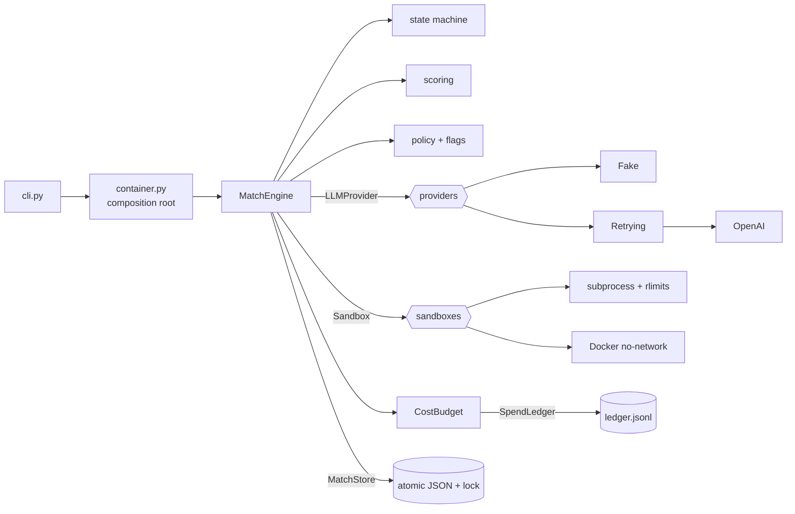

# claude-duel

Two AI agents duel in stages. Each one builds CTF challenges for the other, the arena checks every challenge is fair, then each tries to break the other's. Scoring is deterministic and every match can be replayed.

(Named as a joke on Claude Duet. The idea came from "there should be a claude duel".)

## How a round works
1. **Build**: each agent writes `challenges_per_round` Python programs that print the global `FLAG` only for the right stdin, along with a reference payload.
2. **Validate**: static AST allowlist (pure imports, `sys.stdin`/`sys.stdout` only, no `_` names, size, flag literals), then a sandbox run: the reference payload must reveal the flag and empty input must not. Invalid challenges cost points.
3. **Attack**: the opponent sees the source and description and gets `max_attempts` tries within a token budget, with feedback after each try.
4. **Score**: a pure function. Points scale with difficulty × round, so stakes rise each round.

## Quick start
```bash
uv venv && . .venv/bin/activate && uv pip install -e '.[dev]'
duel run --match-id demo            # fake provider, no network, free
duel replay demo --transcript       # recompute scores from the log
duel resume demo                    # continue a crashed or aborted match
OPENAI_API_KEY=... duel --config configs/dev.toml run   # real models (see below)
```

To use OpenAI, set `provider = "openai"` on the agents in a config file, as in `tests/e2e/test_cli.py`. Only low-cost models from the price table are allowed (default `gpt-4.1-nano`).

## Architecture

Lifecycle: `pending → build → validate → attack → score → (build | complete)`, and any stage can go to `failed`, which `resume` recovers from. See [docs/design.md](docs/design.md), [requirements](docs/requirements.md) and the [ADRs](docs/adr).

## Cost controls
- Allowlist of low-cost models with a configurable `[prices]` table.
- Per-match caps (calls, tokens, USD; $0.25 dev / $0.50 staging / $1.00 prod), per-run caps, and a persistent ledger (`.duel/ledger.jsonl`) with a $40 lifetime ceiling. Once that ceiling is hit, new work is refused.
- A provider `insufficient_quota` error is never retried. The match fails cleanly and can be resumed later.

## Threat model
| Threat | Mitigation |
|---|---|
| Challenge code escapes the sandbox (network, files, processes) | AST allowlist; flag and source sent over stdin (never argv or environ); real-model matches only run in Docker (`--network none`, read-only rootfs, cap-drop ALL, no-new-privileges, seccomp, non-root, pids/memory/CPU limits, container removed on timeout) and fail closed if the daemon is unreachable; subprocess sandbox (fake provider only) adds rlimits incl. no forks and kills the whole process group |
| Infinite loops and memory bombs | CPU + wall-clock + memory limits; output truncated |
| Flag leakage to the attacker | Flags are HMAC-derived by the arena and never shown to authors; prompts are guarded (`FlagLeakError`); feedback and logs are redacted; flags are never persisted |
| Trivial or unsolvable challenges | Reference payload must succeed and empty input must fail |
| Prompt injection inside challenge text | The attacker only produces stdin. Model output is never executed by the arena, only parsed as JSON |
| Secrets in logs | Keys only come from env and are held as `SecretStr`; the JSON log formatter scrubs keys and flags |
| Score tampering | hash-chained event log; `duel replay` refolds it, rescores and flags mismatches |
| Runaway spend | Budget circuit breaker + ledger ceiling |

**Caveat:** the subprocess sandbox is defence in depth, not a security boundary, so the arena refuses to run real-model matches on it. Set `DUEL_DOCKER="sudo docker"` if your user cannot reach the Docker socket.

## Development
`ruff check . && ruff format --check . && mypy src && pytest`. Live test: `pytest -m live` (needs `OPENAI_API_KEY`; costs well under $0.01).

Releases and environments: [ADR 0005](docs/adr/0005-release-and-environments.md).
